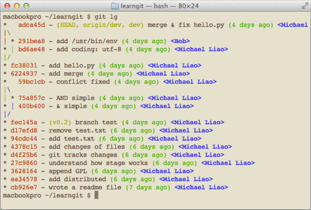

# 配置别名

有没有经常敲错命令？比如`git status`？`status`这个单词真心不好记。

如果敲`git st`就表示`git status`那就简单多了，当然这种偷懒的办法我们是极力赞成的。

我们只需要敲一行命令，告诉Git，以后`st`就表示`status`：

```plain
$ git config --global alias.st status
```

好了，现在敲`git st`看看效果。

当然还有别的命令可以简写，很多人都用`co`表示`checkout`，`ci`表示`commit`，`br`表示`branch`：

```plain
$ git config --global alias.co checkout
$ git config --global alias.ci commit
$ git config --global alias.br branch
```

以后提交就可以简写成：

```plain
$ git ci -m "bala bala bala..."
```

`--global`参数是全局参数，也就是这些命令在这台电脑的所有Git仓库下都有用。

在[撤销修改](../../time-travel/restore/index.html)一节中，我们知道，命令`git reset HEAD file`可以把暂存区的修改撤销掉（unstage），重新放回工作区。既然是一个unstage操作，就可以配置一个`unstage`别名：

```plain
$ git config --global alias.unstage 'reset HEAD'
```

当你敲入命令：

```plain
$ git unstage test.py
```

实际上Git执行的是：

```plain
$ git reset HEAD test.py
```

配置一个`git last`，让其显示最后一次提交信息：

```plain
$ git config --global alias.last 'log -1'
```

这样，用`git last`就能显示最近一次的提交：

```plain
$ git last
commit adca45d317e6d8a4b23f9811c3d7b7f0f180bfe2
Merge: bd6ae48 291bea8
Author: Michael Liao <askxuefeng@gmail.com>
Date:   Thu Aug 22 22:49:22 2013 +0800

    merge & fix hello.py
```

甚至还有人丧心病狂地把`lg`配置成了：

```plain
git config --global alias.lg "log --color --graph --pretty=format:'%Cred%h%Creset -%C(yellow)%d%Creset %s %Cgreen(%cr) %C(bold blue)<%an>%Creset' --abbrev-commit"
```

来看看`git lg`的效果：



为什么不早点告诉我？别激动，咱不是为了多记几个英文单词嘛！

### 追加改动

有时候，我们用`git commit`提交后，发现还有改动的文件忘记提交了，如果再提交一次，就变成了两次提交，不好看。

怎么办？

Git的`commit`命令提供了一个`--amend`参数，允许再次提交时，合并到上一次的commit里。我们用`append`别名来封装这个操作：

```plain
git config --global alias.append '!git diff --cached --quiet && echo "nothing to append to last commit." || git commit --amend --no-edit'
```

注意：用Windows的PowerShell时，要这么写命令：

```plain
git config --global alias.append "!git diff --cached --quiet && echo 'nothing to append to last commit.' || git commit --amend --no-edit"
```

现在，假设有文件`A.txt`和`B.txt`都做了改动，先正常提交文件`A.txt`的改动：

```plain
$ git add A.txt
$ git commit -m "fix bug 1001"
```

提交后我们才发现忘了把`B.txt`加进去。不要慌，先`add`再`append`，，把`B.txt`的改动追加到`fix bug 1001`里：

```plain
$ git add B.txt
$ git append
```

现在，`fix bug 1001`这个提交就同时包含了`A.txt`和`B.txt`的改动。

如果当前没有任何待提交的改动，`git append`会提示`nothing to append to last commit.`，什么也不干，然后直接退出：

```plain
$ git append
nothing to append to last commit.
```

### 配置文件

配置Git的时候，加上`--global`是针对当前用户起作用的，如果不加，那只针对当前的仓库起作用。

配置文件放哪了？每个仓库的Git配置文件都放在`.git/config`文件中：

```plain
$ cat .git/config 
[core]
    repositoryformatversion = 0
    filemode = true
    bare = false
    logallrefupdates = true
    ignorecase = true
    precomposeunicode = true
[remote "origin"]
    url = git@github.com:michaelliao/learngit.git
    fetch = +refs/heads/*:refs/remotes/origin/*
[branch "master"]
    remote = origin
    merge = refs/heads/master
[alias]
    last = log -1
```

别名就在`[alias]`后面，要删除别名，直接把对应的行删掉即可。

而当前用户的Git配置文件放在用户主目录下的一个隐藏文件`.gitconfig`中：

```plain
$ cat .gitconfig
[alias]
    co = checkout
    ci = commit
    br = branch
    st = status
[user]
    name = Your Name
    email = your@email.com
```

配置别名也可以直接修改这个文件，如果改错了，可以删掉文件重新通过命令配置，或者直接删掉配置文件错误的那一行。

### 小结

给Git配置好别名，就可以输入命令时偷个懒。我们鼓励偷懒。
